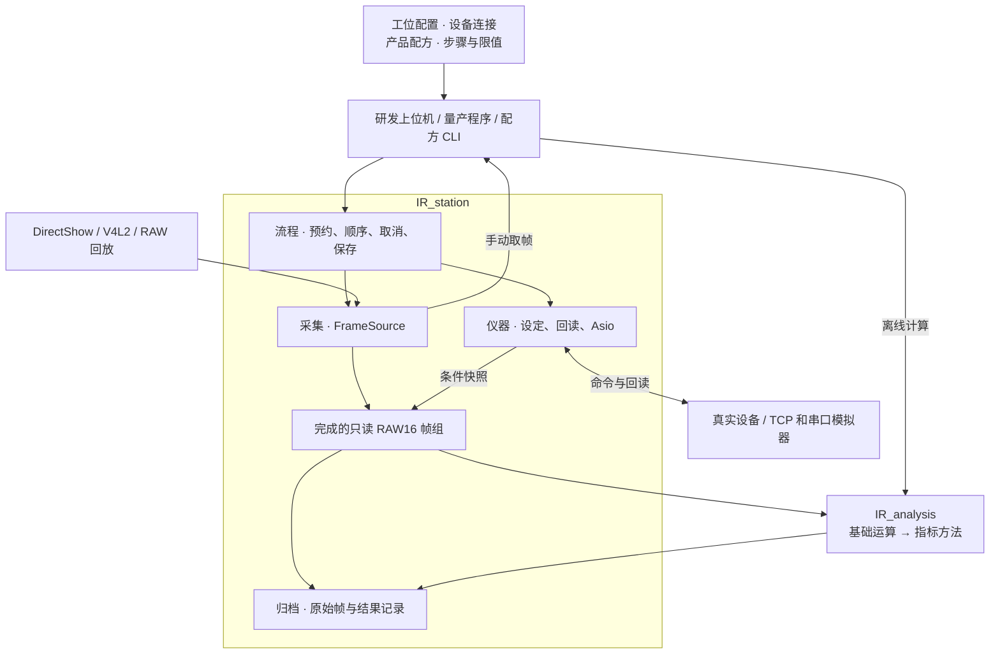

# IR SDK 框架与二次开发实施计划

适用基线：`codex/sdk-cross-platform` 的 `ae76e32`（IR SDK 1.1.0 交接提交）。当前已在独立 Windows 迭代开发分支 **`windows-iter1`**（自 `ae76e32` 切出，原 `codex/sdk-cross-platform` 保持不变）推进后续迭代，并在本机采用纯 Windows 自动化验证流程（`tools/verify_windows.ps1` + `tools/package_sdk.py --windows-only`）。本文件同时记录已完成框架工作、四阶段迭代路线图以及后续硬件验收要求。

## 四阶段迭代路线图（Windows 迭代主线）

| 迭代 | 目标版本 / 主题 | 核心范围 | 验证与交付方式 |
|---|---|---|---|
| Iteration 1 | **1.1.0 收口与 Windows 可迭代工程地基** | 修复 `device_api.cpp` `workflowOwner` 竞态与 `it6332a.cpp` 区域无关数值格式化；新增 `IR_StationVersion()`、Windows DLL `VERSIONINFO` (`1.1.0.0`) 及 `result.json` 追溯字段（`station_version`/`source_commit`/`started_utc`/`finished_utc`）；提供 Draft 2020-12 JSON Schema 与 `$schema`；扩展模拟器故障注入（`--drop-command`/`--drop-count`/`--fragment`/`--log-io`）与 CLI 统一 `run_status=CANCELLED/ERROR`；收紧客户交付包文档卫生并新增 `--windows-only` / `--require-clean` 与 `tools/verify_windows.ps1` | 在 `windows-iter1` 分支通过 `tools/verify_windows.ps1` 端到端验证并生成 `IR-SDK-1.1.0-Windows.zip`（不覆盖历史双平台包） |
| Iteration 2 | **1.2.0 零 Qt / 零 OpenCV 核心算法迁移 + Stage A 可组合算子与无存盘多 Burst 支撑**（已完成本机 Windows 验证） | 将 Noise3D 与 GB/GJB 核心指标迁入纯 C++20 `IR_analysis`，同步落地 P0 修复（C# `InlineArray(15)`、`IRGbCriteria` 可配置短路/断路阈值、`ir_analysis_c_sample` 纯 `IR_analysis` 链接、Python 显式 `restype`）、11 个可组合基础算子（NUC、`15×15` LRNU/HRNU、二元算术/阈值与掩码组合、Radix-2/Bluestein 任意长 1D FFT 与多通道频谱、`IR_GjbEvaluateBurstMetrics`），以及 `IR_Station` 5 小时无存盘温漂支撑（`IR_FlushFrames`、DirectShow `QueueCapacity=64`/V4L2 `BufferCount=8`、`IR_WaitBlackbodyStable`） | `windows-iter1` 上 CTest 12/12、`dumpbin` 零第三方运行依赖、`ir_analysis_c_sample.exe` 零 `IR_station.dll` 依赖、`FileVersion=1.2.0.0`、`IR-SDK-1.2.0-Windows.zip` 与独立 C/Python/TCP 模拟通过 |
| Iteration 3 | **1.3.0 Schema v2 / 多条件流程 / 安全下电 / FrameQueue 并发**（已完成干净基线 `f3e99be`） | **Stage 1.3-A（提交 `e903655`）**：`station/acquisition/frame_queue.*` 有界无损测量队列（默认 64 帧）与后台实时泵、`IR_SetFrameQueueCapacity`、`IR_TryReadLatestFrame`、`IR_GetCaptureStats` 与 `ir_drift_nodisk.py`；**Stage 1.3-B/C（干净基线 `f3e99be`）**：Schema v2 引擎（`ExecutionContext` 命名数据槽、多温点交错、`flush_frames`、可选/`subdir` 多批 `save_raw`、`repeat_burst` 周期流式 CSV）、开放 `MetricRegistry`（14 项算子 + `params` 透传）、`safety.blackbody_standby` 收尾与 C# `.NET 10.0.404` 修复 | CTest 14/14、`IR-SDK-1.3.0-Windows.zip` `-RequireClean`（SHA-256 `53d4f7f3...`）与 Step 13 C# 四模式全部通过 |
| Iteration 4 | **1.4.0~1.7.0 硬件准备、全外设对齐、六路 `com0com` HIL 与上位机无侵入联调闭合**（`1.4.0` `122a25c`、`1.5.0` `99d497d`、`1.6.0` `ab87703` 已锁定；**Stage 1.4-C `1.7.0` 本轮落地验证**） | **Stage 1.4-A（1.4.0，`122a25c`）**：设备发现 C ABI、`ir_capture_accept`、`IR_FlickerDetectU16` 与高斯滤波；**Stage 1.4-B（1.5.0，`99d497d`）**：GWS STEN 烘箱、Keithley DMM6500、探测器 `0xCC` 串口驱动、`IR_RunNoise` 探测器联动与 Schema v2 多仪器步骤；**Stage 1.4-B2（1.6.0，`ab87703`）**：IT6332A TCP/串口统一、制冷机 Modbus RTU（`8N2`）、探测器 `0x41` 电流读取、Schema v2 `detector_register`/`detector_current`/`cooler_read`、组合式虚拟工位 `ir_virtual_station.py`、完整 C# P/Invoke 与 `power_tcp`/`virtual_station_hil` 自动回归；**Stage 1.4-C（1.7.0，本轮）**：`IR_WaitPowerCurrentStable`（`IRPowerCurrentStableSpec`，72 B）+ `power_wait_stable`、纯 C++20 任意尺寸 2D FFT `IR_Fft2dMagnitudeF64`（`IRFft2dSummary`，64 B）+ `fft2d` 算子、永久化 6 对 `com0com`（`COM10..COM21`）并发在环 `tools/verify_com0com_hil.py` 与零侵入 `FPA测试上位机.exe` 联调启动器 `tools/launch_host_hil.ps1` | Stage 1.4-B2（`ab87703`）：CTest 21/21、`1.6.0` 干净包、6 对 `com0com` 并发 HIL 与零侵入 `FPA测试上位机.exe` 启停冒烟均通过；Stage 1.4-C（`1.7.0`）：执行全量 `-RunCom0ComHil` 回归及 `-RequireClean` 出包锁定，随后转入物理硬件与 FX3 实机阶段 |

### 标准差数学口径确认（重要）

- **GJB 噪声图 `vn`**：采用**总体标准差，分母为 `N`（`sample_std = 0`）**，与 `optmeas-usb/autotest/BurstStatistics` 一致，后续以独立 GJB 接口和指标名暴露。
- **既有 `IR_RunNoise` 与 `temporal_noise`**：继续保持**样本标准差，分母为 `N - 1`（`sample_std = 1`，`mean_pixel_sample_std`）**，确保既有 C ABI 与 `result.json` 向后兼容，文档与方法名显式区分两种口径。

## 目标

先交付一套能在 Windows x64 和 Ubuntu 24.04 WSL2 上用模拟设备完整运行的测量框架。保留 `IR_station`、`IR_analysis` 两个动态库及纯 C ABI。测试人员使用配方文件编排已发布步骤；新人从 Git 检出后能用随仓库提供的 Asio 依赖、极小 RAW 和算法指南添加指标。

当前实现已覆盖 RAW/DirectShow/V4L2 三种采集来源（含并发有界 `FrameQueue` 与非阻塞预览）、DOC058 TCP/串口黑体、IT6332A TCP/串口电源（含 `IR_WaitPowerCurrentStable` 电流稳态等待）、GWS STEN 烘箱、DMM6500 万用表、探测器 `0xCC` 控制与电流采样、制冷机 Modbus RTU（`8N2`）、Noise3D/GB/GJB/闪元/2D FFT/可组合算子、Schema v1/v2 多条件流程及无存盘循环、组合式虚拟工位 `ir_virtual_station.py`、6 对 `com0com` 并发 HIL 脚本与上位机零侵入启动脚本，以及 C、C++、C# `.NET 10`、Python 调用样例。FX3 连续真机采集与实机物理硬件继续按实机验收计划单独开展。见[当前验收](../验证记录.md)和[设备支持矩阵](设备支持矩阵.md)。

## 当前实施状态（2026-11-22，1.7.0 Stage 1.4-C Windows 软件闭合）

| 阶段 | 状态 | 已落地内容 | 尚待完成 |
|---|---|---|---|
| 0　接口与构建基线 | 已完成并持续 `-RequireClean` 锁定 | 两个动态库、稳定 C ABI、仓库内固定 Asio 1.36.0、离线 RAW16 样例、自动化验证与干净出包脚本 | 按需同步 Linux 1.7.x 构建与双平台合包 |
| 1　模拟、虚拟 COM 与上位机联调 | **软件与 6 路 `com0com` 闭合** | `ir_sim_devices.py` + `ir_virtual_station.py`（6 设备耦合）+ `setup_com0com_pairs.ps1` + `verify_com0com_hil.py` + 零侵入 `launch_host_hil.ps1` | 物理硬件真机 COM 与实拍对拍 |
| 2　帧组与并发资源 | **并发化完成** | 有界 `FrameQueue`（默认 64 帧）、后台实时泵线程、`IR_TryReadLatestFrame` 非阻塞预览、`IR_GetCaptureStats` 与 `IR_FlushFrames` 不停流切换 | FX3 DirectShow 实机吞吐、`biHeight` 行向与连续帧长稳验收 |
| 3　算法库与开放算子 | **16 项算子全部就绪** | `IR_analysis` 纯 C++ 零 Qt/OpenCV 实现时域/ROI/Noise3D/GB/GJB/两点 NUC/`15×15` 高低频（盒式/高斯）/闪元/1D & 2D FFT（`IR_Fft2dMagnitudeF64`）/多通道频谱及单 Burst 评估 | EMVA 1288（按需）与实拍大数据参考对照 |
| 4　测试流程编排 | **Schema v1/v2 就绪** | v1 兼容 + v2 多条件/多温点/跨步槽位、`power_wait_stable`、`fft2d`、`repeat_burst` 无存盘流式 CSV、全 6 类仪器步骤与 `safety.*` 待机回位 | 结合实机工艺完善现场工艺限值 |
| 5　交接与出包 | **Windows 自动验证就绪** | Windows `-RequireClean` 打包、`-RunCom0ComHil` 6 路虚拟串口验证、`MANIFEST.sha256`、`package_sdk` 卫生扫描、独立 C/C++/CLI/Python/C# `.NET 10` 全流程通过 | 按需补充现场工艺配方模板 |
| 6　真机与标准 | **转入硬件阶段验收** | 保留 DirectShow 实机入口、`ir_capture_accept` 拷机命令行与 `IR_NI_IMAQ` 占位 | FX3 连续 100 帧/30 min、真实仪器 COM 与真机协议对拍 |

流程内各消费端通过 `ExecutionContext` 有界批次/像元图/掩码槽位顺序复用只读批次；预览与监控线程并发通过无锁/独立锁 `IR_TryReadLatestFrame` 读取最新帧快照，不阻塞测量主流程。

## 设计取舍

| 原则 | 在 IR SDK 的具体做法 | 怎么验证 |
|---|---|---|
| S · 单一职责 | 驱动负责通信和回读，采集负责 RAW16，分析负责计算，流程负责顺序和资源。产品限值由配方工具或量产应用使用。 | 修改产品限值只改配方。黑体协议更新不需要改分析库。 |
| O · 对扩展开放 | 新后端实现 `FrameSource`，在工厂和构建中登记。新算法进 `analysis/`，需要从配方调用时在步骤表登记。 | 变更集中在对应实现、入口和测试。 |
| L · 可替换 | 实采与回放遵守同一帧契约和缓冲区寿命，各自报告可得的真帧号和时基。流程区分结束、超时、缺帧和取消。 | 同一基准像素经回放或模拟采集进入相同计算入口。遇到缺帧只交付完整的连续前缀。 |
| I · 接口按能力拆分 | 黑体接口表达设温与回读，电源接口表达通道、输出状态和 V/A，取帧接口与计算接口独立。 | 流程只预约用到的设备，独立分析只需链接 `IR_analysis`。 |
| D · 依赖约定 | 流程通过类型明确的操作调用仪器、取帧和分析，驱动在内部复用 Asio，模拟器通过正式通信端点接入。 | 同一条流程可以连 TCP 黑体或虚拟串口黑体，且无需启动上位机界面。 |

采用“端口与适配器”组织真机、回放和模拟。从一条能运行的测量链路开始，第二种实际用例出现时再提取共用部件。资源用现有句柄和作用域清理管理，步骤状态用小枚举表达。公开接口写清输入、输出、单位、超时、失败时的部分结果和调用线程。 [Robert C. Martin 的 SOLID 说明](https://blog.cleancoder.com/uncle-bob/2020/10/18/Solid-Relevance.html) · [Cockburn 端口与适配器](https://alistair.cockburn.us/hexagonal-architecture)

### 四层的接入位置



- 新仪器进入 `station/instruments/<设备类别>/`，共用端点登记、占用和实际用到的串口／TCP 操作。接入第二类仪器时，从黑体会话中提取通用登记。
- 新相机进入 `station/acquisition/<来源>/`。驱动缓冲、行跨度、像素排列和有效位由后端处理。输出沿用[现有取帧接口](../include/IR_station.h)。
- 新算法进入 `analysis/`，按基础计算和有具体输入的指标方法组织。需要子目录时随第二个指标落地。
- 测量步骤及资源协调进入 `station/procedures/`。CLI 复用同一路径。预览渲染、工单、产品判定和界面由上位机或配方工具负责。

## 阶段 0　固定接口和交付基线

**输入**是 1.0.1 源码、已交付包、已有 CTest 和两组真实离线 RAW。**输出**是后续发布所用的接口清单、装包入口和可复跑基线。

1. 列清现有 C 函数、结构、状态码、字符串编码和内存归属。同系列保留已发布签名、布局及单位。各平台留一份本版编译的 C 程序供下次直接换库验证。
2. 将同一提交的 Windows、Linux 安装目录通过一个仓库内的入口合包。记录提交、平台、依赖和文件校验清单。Python 模拟工具随测试材料提供，运行库和 C 客户端可单独部署。
3. 沿用 `[20, 22]` 两帧和既有黑体流程作为最小回归。记录配置版本和数据来源。真实 RAW 只读，构建和输出进入实验目录。

**通过条件**是从安装内容独立编译或运行样例，得到两帧、均值 `21 DN`、样本时域噪声 `1.4142135623730951 DN`，并核对包及运行依赖。现有验收结果作为基线，首个新包按相同入口复验。

## 阶段 1　让模拟设备可以独立启动

复用[现有黑体模拟和测试](../sdk_tests/blackbody_mock_test.py)。先把已验证的模拟响应作为可手动启动的工具。输入为型号、端点和场景，启动后输出实际 TCP 地址或串口路径。按请求序号或状态触发故障，记录收到的命令和发出的应答。正式驱动通过同样的 TCP 或串口 API 连接。

| 用例 | 输入与行为 | 输出及通过条件 |
|---|---|---|
| TCP 黑体 | Windows、WSL 各起 PCN7-LT 本机模拟服务，使用 DOC058 身份、设温、实际温度、稳定状态和读回。 | 正式 TCP 驱动完成配方。覆盖分段应答、未稳超时、读回不匹配、断线后恢复与重试耗尽。 |
| 串口黑体 | WSL 用一对 PTY（伪终端）连接模拟器和正式 DCN1000 串口驱动。复用状态模型，单独验证串口报文与节拍。 | 完成与 TCP 相同的测量。保留串口事务截止时间、取消与重开结果。 |
| 串口电压源 | IT6332A 已接入身份确认、通道选择、V/A 设定与回读、输出开关和配方读数步骤。 | 复用正式 Asio 串口路径、端点判重和占用机制。PTY 模拟已覆盖短暂断连后恢复，以及重连耗尽后停止流程；黑体配方不要求连接电源。 |
| 模拟图像 | 复用 RAW 回放。新增有明确像素位置的 `2×2` RAW 验证几何、有效位、行列和 ROI。使用缺帧索引和提前结束模拟不完整批次。 | 几何、像素和来源可逐帧核对。读完、缺帧和取消有不同结果，未满批次进入异常收尾。 |

Windows TCP 模拟作为基础验收。Windows 串口集成使用现有可用的虚拟 COM 对或确认的双串口连线单独验收。WSL PTY 的结果记录为虚拟串口，实际 COM、电气接口和硬件断连单列。电源协议按[现有串口实现](../../../optmeas-usb/power/It6332aSerialTransport.cpp)与[ITECH 编程指南](https://usa.itechate.com/uploadfiles/%E7%94%A8%E6%88%B7%E6%89%8B%E5%86%8C/user%20manual/it6300/IT6300%20Programming%20Guide-EN.pdf)交叉核对。 [Python PTY 文档](https://docs.python.org/3.12/library/pty.html)

**通过条件**是从全新终端启动模拟器，打开并读回，跑完噪声样例，主动触发一项失败，再在同一采集线程重跑成功。控制应答丢失时按型号协议读回确认，重连次数有限，重连后重新核对身份和状态。无法确认时停止当前测量。

## 阶段 2　完成批次交接、占用和多消费者

固定噪声流程和 JSON 配方复用 `Measurement` 的占用和停止范围，黑体共用等稳实现。JSON 流程在取帧后停流并执行设备收尾，随后释放设备。全过程保留采集入口的占用，直到计算及归档结束。 [流程占用与等稳](../station/procedures/measurement.cpp)

| 操作 | 输入 | 输出及资源行为 |
|---|---|---|
| 预检和预约 | 必需设备与采集源、目标状态、帧数和预计缓冲量 | 可用连接、设备占用和缓冲额度。无法取得资源时在第一条设备设定前返回原因。 |
| 确认条件 | 已预约设备、温度／电压设定、容差、等待上限 | 回读设定值、实际值、状态和配置版本。只打开与预约本配方实际引用的设备。 |
| 采集和交接 | 已确认的条件、帧数、单帧超时 | 只读 RAW16、几何、有效位、帧号、时间来源、条件及完成帧数。停止采集后执行设备收尾，释放配方已不再使用的设备。 |
| 计算和归档 | 同一份已完成帧组、算法参数、输出位置 | 数值、单位、方法版本、保存状态。共享像素保持有效到最后一个消费者结束，任务各有输出和临时数据。 |
| 结束或取消 | 当前阶段、已完成帧、收尾约定 | 状态码、失败步骤、帧数、收尾结果。取帧或通信在明确的边界响应停止，正在运行的同步计算或写入按安全边界收尾。下一次运行可重新开始。 |

一进程一个采集源，由打开它的工作线程负责全部采集操作。采集线程及时归还驱动缓冲，测量批次按可得的驱动信息检查完整性，并核对采集中配置版本。设备断线让当前批次条件失效时，恢复后重新确认条件并开新批次。收尾时按配方确认需要恢复哪些状态。离线分析独立调用。

首版按单批次运行。预览单独取帧，自动配方通过只读 `FrameBatch` 交付指标和同步归档。RAW 容量按实际像素字节检查，`1280×1024` 千帧约 `2.44 GiB`。以后确需并行时，可按数据用途规定队列容量和满队列行为，归档与测量保持完整批次，预览可以保留最新值。引入有内部并行的算法库时，把库内线程计入工位预算。 [areaDetector 的共享缓冲](https://areadetector.github.io/areaDetector/ADCore/NDArray.html) · [GStreamer 队列上限](https://gstreamer.freedesktop.org/documentation/coreelements/queue.html) · [OpenCV 多线程池说明](https://docs.opencv.org/4.13.0/de/d55/group__core__parallel__backend.html)

**首版通过条件**是等稳期间外部操作已预约设备返回 `IR_BUSY`，取消后原工作线程能重跑。无效几何或超额批次在设备命令前失败，取消与提前结束能执行配方声明的收尾。完整批次保存后能重放复算，缺帧或写入失败时返回测量异常。慢预览、慢计算和慢写盘下的吞吐及内存峰值在真机阶段记录。

## 阶段 3　让新人独立接入一个算法

首个任务选矩形 ROI（感兴趣区域）的 DN 均值。它验证算法放置位置、数据契约、离线对照和配方调用。完整标准方法随后按条款接入。

1. 从 `IR_FrameStatisticsU16` 和[现有双条件样例](../sdk_tests/analysis_conditions.c)学习输入布局。新指标输入写清所需批次数、条件、几何、有效位和 ROI／掩码。第一种多条件标准方法落地时，再定义该方法实际需要的帧组结构。
2. 在 `analysis/` 增加方法，复用适用的基础统计。输出数值、单位和方法版本。需要图或掩码时定义相应的调用方缓冲区。需要从配方调用时登记一个步骤。新增方法的说明包含有效输入、算法版本、失败状态及数值容差。
3. 小样例用两帧 `[[20,40],[60,80]]` 和 `[[22,42],[62,82]]`，左列 ROI 预期 `41 DN`，全图预期 `51 DN`。用无效 ROI 和两组真实 RAW 对照验证。开发指南注明从安装后的 C 工程、C# 或 Python 调用。
4. 正式 GJB／EMVA 由测量人员给出编号、版本、条款、输入条件、参考结果和容差。算法更新用同一数据复算，便于比较版本。OpenCV 随确有需要的方法进入分析库内部。

**通过条件**是一位新人按照指南独立提交一个指标，离线示例得到预期结果，并让现有 CLI 发布的配方选到它。两平台通过新方法用例和已有噪声回归。仪器驱动继续用原版本。

## 阶段 4　让后端测试人员编排步骤

支持一份按顺序执行、有类型的步骤清单。工位文件维护连接方式与设备别名，测试配方维护步骤、目标条件、选用的指标和限值。JSON 只在入口解析，执行集中在 `station/procedures/`。C# 和 Python 通过现有 `IR_CheckRecipeJson`、`IR_RunRecipeJson` C ABI 调用同一执行器，不另做语言专用执行逻辑。 [VisionMaster 图像源与流程队列](https://pinfo.hikrobotics.com/hkws/unzip/20231101163730_26101_doc/pdf.pdf)

| 步骤 | 配方填写 | 执行输出 |
|---|---|---|
| 设定并确认黑体 | 设备别名、目标温度、容差、等稳窗口和时限 | 回读设定值、实际温度和稳定状态。仅用于需要黑体的流程。 |
| 捕获帧组 | 采集源别名、条件引用（如需要）、帧数、单帧时限、批次名 | RAW16 帧组及其来源、条件和帧信息。 |
| 运行指标 | 方法及版本、输入批次名、所需参数和结果名 | 数值、单位、方法版本，按需输出图或掩码。 |
| 归档 | 批次名、结果名、新输出位置 | 完整 RAW、索引和结果文件，或明确的保存错误。 |
| 产品判定 | 已成功的指标与限值，单位一致 | 有限值时为 `PASS` 或 `NG`；没有限值时为 `COMPLETED`。运行错误或取消由 C ABI 返回状态和失败步骤，不发布部分结果目录。 |

电源步骤用模拟器验收。开输出时由配方声明 `off_after_run: true`，SDK 在成功、失败或取消时关闭对应通道并确认回读。重连与设备占用由执行器及驱动管理。多温点优先用有类型的条件列表，每个条件确认后产出新批次。分支、脚本和拖拽编辑由实际需求触发。

### 首轮配方与命令行示意

当前可运行的 schema v1 示例为 [`offline.json`](../examples/stations/offline.json) 与 [`noise_roi.json`](../examples/recipes/noise_roi.json)；包含黑体的示例见 [`sim_tcp.json`](../examples/stations/sim_tcp.json) 与 [`noise_blackbody.json`](../examples/recipes/noise_blackbody.json)。工位配置将设备别名绑定到 TCP、串口或 RAW 回放；流程按步骤引用别名，并指定指标参数、单位一致的限值。示例限值 `2.0 DN` 只用于模拟数据。

```text
ir_run_recipe --check --station examples/stations/sim_tcp.json --recipe examples/recipes/noise_blackbody.json --output examples/output/demo-001
ir_run_recipe --run --station examples/stations/sim_tcp.json --recipe examples/recipes/noise_blackbody.json --output examples/output/demo-001
```

`--check` 检查字段、设备别名、输入引用、步骤顺序、范围和限值单位。`--run` 还会用实际画幅检查批次及 ROI，只打开本次引用的仪器。**通过条件**是从交付包运行黑体等稳配方和离线多指标配方，修改限值复现 `PASS` 与 `NG`，用模拟故障验证 `IRRecipeResult` 中的失败步骤、完成帧数及收尾状态。成功归档实际配方、算法版本、采集来源、回读条件和指标。

## 阶段 5　按角色交付并验收更新

| 使用者 | 拿到什么 | 独立完成的验收任务 |
|---|---|---|
| 客户应用开发 | 两平台库、头文件、CLI、C／C++／C#／Python 示例和支持矩阵 | 解包运行离线配方，并从所用语言读取同一结果。 |
| 后端测试人员 | 工位与配方模板、步骤说明、模拟器启动入口、小 RAW、正常和故障场景 | 不重编 SDK，补写一份配方，先检查再运行，从结果区分产品超限和测量异常。 |
| 新人和实习生 | 同版本源码、固定依赖、构建说明、算法样板和验收数据 | 按阶段 3 添加方法，改必要文档并提交可复算结果。 |

从同一干净提交构建、运行 CTest、安装并生成双平台压缩包。用上一版编译好的 C 程序直接换库。新配方和语言样例用安装内容独立运行，覆盖含中文及空格的解压路径。产物写清 Windows／WSL、TCP／PTY／COM、回放／实机各自通过的范围。小数据和模拟工具随交接材料提供，测试用 H 盘源记录留在原位。

## 阶段 6　真机与标准接入

1. **FX3。** 按现有计划先跑 Windows 640×512 已知图案的连续 100 帧，再验证 WSL V4L2。确认像素、时基、帧号来源、取消和重启。记录轻载和预览／写盘负载下的吞吐、在途字节峰值和失效批次。
2. **真实仪器配方。** 由现场确认型号、协议、参数和失败收尾。用黑体与探测器完成设定、回读、等稳、取帧、计算和保存，再按首份量产配方接入电源、万用表或烘箱。
3. **PCIe-1433 和正式指标。** 1433 作为 Windows 可选后端，单独验证驱动、相机配置和 RAW16。Linux 兼容性按实际板卡和驱动确认。GJB、EMVA 和专项校准按条款、参考数据和跨平台容差逐项验收。
4. **何时扩大框架。** 先用同一工位测出采集、计算、写盘的瓶颈，再考虑多计算任务、SIMD 或 GPU。由使用人员提出改变步骤顺序、多个应用共享设备或多工位并行的需求后，再评估图形编辑、进程间接口和多源会话。

## 分工与交接顺序

1. SDK 维护者先做阶段 0，确定帧组、设备占用和状态约定。驱动和流程开发人员分别推进阶段 1、2，通过同一条固定噪声配方合并验收。
2. 帧组与步骤输入明确后，新人可先做阶段 3 的离线算法，测试人员可同步起草阶段 4 的配方。用一个新指标和两条流程验证扩展成本。
3. 阶段 5 请实际接手的开发和测试人员分别完成一次任务。框架交接以两平台可重复出包、离线一致、异常可定位和接手人能独立修改为准。阶段 6 用独立的硬件和标准验收记录确定量产范围。
