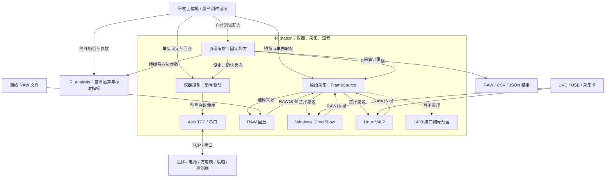

# IR 测试 SDK 实施计划 · 先搭四层框架

适用分支 `codex/sdk-cross-platform`。第一份交付是能编译、能从 C 程序调用、能用极小样本跑通的四层 SDK。Windows x64/MSVC 和 Ubuntu 24.04 WSL2/GCC 共用源码。交付 `IR_station`、`IR_analysis` 两个动态库，研发人员可以单步调用，量产程序可以调用固定流程。

## 四层的源码位置和输入输出

| 层 | 目录及首个实现 | 输入 → 输出 | 新功能落点 |
|---|---|---|---|
| 仪器控制 | `station/instruments/` 按型号实现设备协议；`transport/asio_link.*` 共用 TCP 和串口 | 型号、连接配置和目标状态 → 设备身份、设定回读、实际状态或通信错误 | 新仪器按设备类型新增驱动，声明安全重试边界。流程开始前预约所用句柄 |
| 原始采集 | `station/acquisition/frame_source.*` 定义取帧约定；RAW 回放、DirectShow、V4L2 实现该约定。1433 仅保留接口编号 | 来源和单帧超时 → 紧密排列的 `[帧][行][列]` RAW16、实际几何、有效位、帧信息和完成数 | 新相机只实现统一生命周期及数据约定。寄存器和开流控制归仪器驱动 |
| 指标计算 | `analysis/` 与 `include/IR_analysis.h` | 原始帧组、几何及方法参数 → 像元图、汇总值、单位及算法版本 | 先复用基础统计，再按具体 GJB/EMVA 条款接入标准方法。OpenCV 只在算法需要时作为内部依赖 |
| 流程编排 | `station/procedures/` | 有类型的配方、指定的设备及采集源 → 步骤状态、完成帧数、指标和保存记录 | 固定流程负责预检占用、设备设定、取帧、计算、保存与收尾。不引入通用脚本引擎 |

调用关系为 `IR_RunNoise → 仪器设温与读回 → 采集源取帧 → IR_FrameStatisticsU16 → 返回结果`。流程层决定前三个动作的执行时机。仪器驱动只依赖通信实现，采集层只交付原始帧，计算层只接收数据。研发应用也可直接调用 `IR_SetBlackbody`、`IR_ReadFrames` 或 `IR_FrameStatisticsU16`。

预览、单独采集和流程共享同一个采集源，因此一次只允许一个采集操作。连续测量按顺序处理帧并报告已知帧缺口；预览界面可以自行降低刷新率。分析库只接收帧和条件，不负责连接设备、流程调度或量产合格判定。

## 商用框架参考及采用边界

| 参考实现 | 对本 SDK 有用的做法 | 本项目采用方式 |
|---|---|---|
| [MVTec HALCON File Acquisition](https://www.mvtec.com/fileadmin/Redaktion/mvtec.com/06_downloads/interfaces/hAcqFile.html) | 离线图像使用常规采集接口，硬件调试与文件回放能走同一条数据路径 | `IR_RAW_REPLAY` 与实时源共用 `FrameSource` 和 RAW16 数据约定 |
| [Basler pylon Grab Strategies](https://docs.baslerweb.com/pylonapi/cpp/sample_code#grab_strategies) | 有顺序交付与只保留最新图像等不同策略；测量与预览对漏帧的容忍不同 | SDK 采集按序交付，发现可观测缺帧返回 `IR_FRAME_GAP`；预览刷新节流放在上位机 |
| [IVI Driver Architecture](https://www.ivifoundation.org/About-IVI/Driver-Architecture.html) | 型号驱动负责设备能力，底层 I/O 可复用，只有需要互换性时才引入仪器类别接口 | 按实际型号写驱动，Asio 只复用 TCP/串口 I/O；暂不创建通用仪器类或插件层 |
| [NI TestStand Result Processing](https://www.ni.com/en/support/documentation/supplemental/08/teststand-report-generation-and-customization.html) | 测量时先收集结构化结果，结果文件和进一步处理再分开 | SDK 记录数据、参数和指标；量产应用持产品限值与合格/不合格/测量异常判定 |

这些框架的通用边界适合作为参考，但 SDK 首版不复制其配置系统、插件管理或可视化流程编辑器。当前两个库、固定 C 接口和有类型配方更便于新人沿既有入口接入新型号。

## 已完成：四层框架与双平台验收

2026-11-20 在首个框架快照 `07bc421` 上完成设备互斥、掉线重连边界、TCP 端点规范化、RAW 回放验收和结果记录更新。当前交付仍为 `IR_station` 与 `IR_analysis` 两个库；仪器控制、FrameSource 采集、固定流程位于 Station，指标独立位于 Analysis。NI-IMAQ 原型已从当前构建移除，只保留 `IR_NI_IMAQ = 4` 并在两平台返回 `IR_UNSUPPORTED`。Windows CTest 4/4、Ubuntu 24.04 WSL2 CTest 5/5 通过，安装包重新编译的纯 C 示例和模拟黑体流程通过。此次没有进行新的 FX3 实机连续采集或 1433 硬件验收；详见[验证记录](验证记录.md)。

| 顺序 | 基于现有代码做什么 | 交付与通过条件 |
|---|---|---|
| 1. 明确目录和编译边界 | 沿用已有四个目录，在根 CMake 按仪器、采集、流程、计算分组列源文件。前三组编入 `IR_station`，计算编入 `IR_analysis`。将平台后端源码与对应 CMake 选择一并纳入 Git。按实际实现增加文件 | 同一检出能用两端 preset 编译。`IR_analysis` 可单独调用；公开 C 头文件只暴露 SDK 类型。每个模块在 `SDK.md` 有入口和调用示例 |
| 2. 整理 Asio 接入 | 仓库已有 standalone Asio、`ASIO_STANDALONE` 和 `AsioLink`。复用 `asio::ip::tcp::socket`、`asio::serial_port` 和共用的读写截止时间。把连接、字节收发放在 `transport/`，DOC058 编解码、应答解释和回读放在 `blackbody/` | 从 CMake 能看出 Asio 为 Station 私有依赖。从黑体入口能追到同一个传输实现。两端通过现有 TCP 模拟用例，WSL 通过现有虚拟串口用例；Windows 实物串口列入硬件阶段 |
| 3. 理顺采集和计算接口 | 沿用 `FrameSource` 的打开、启动、读取、停止、关闭生命周期。采集 C 接口注释写清 RAW16 排列、缓冲区容量、线程及 `completed` 在失败时的含义。计算接口注明输入形状、样本标准差分母及输出单位 | 使用现有小 RAW 回放即可独立检查像素、帧数和元数据；同一组像素能直接交给 Analysis。沿用现有 C 客户端、回放测试与头文件 |
| 4. 跑通一条四层流程 | 保留 `IR_RunNoise` 作为唯一首轮固定流程。在源码中按设温、确认等稳、采帧、计算、可选保存写清步骤。复用 `sdk_tests/blackbody_mock_test.py` 已有的模拟黑体和两帧小样本，补齐同一次调用的噪声断言 | 设温 32 °C，读两帧 1×1、像元分别为 20 和 22 DN。成功时 `completed=2`、均值 21 DN、样本时域噪声 √2 DN；模拟黑体未稳时返回超时、`completed=0`。Windows 和 WSL 均通过这一用例 |

首轮在两个平台各编译安装两个库，运行上述用例和安装包纯 C 示例，记录提交号、命令和用例名称。此时即可评审目录、依赖关系和公开接口。复用现有设备句柄与帧类型，保留 Station 用于 JSON 和文件的 QtCore；实际出现第二个需要复用的功能时再提取公共代码。

本轮关闭的审查项和结果如下：

| 范围 | 输入与实施 | 输出与验收 |
|---|---|---|
| C 结果结构 | 让 `real_raw_parity.py` 按公开头文件分配 `IRNoiseResult`，布局检查为 32 字节，`failed_step` 和 `cleanup_status` 位于偏移 24、28 | 两平台的安装库均能安全接收结果；兼容旧 RAW 索引，只比较 SDK 支持且由该帧选中的时间字段 |
| 黑体重连 | TCP 和串口模拟应答丢失、断线、重试耗尽、断开后再次调用 | 每次恢复前等 500 ms；首次恢复算入最多三次。重试耗尽后报设备错误；设温应答丢失时只读回，不重复发送设温 |
| 仪器占用 | 配方等待等稳期间，其他线程尝试设温、读回及关闭；另用 `localhost` 和 `127.0.0.1` 同端点打开 | 已预约句柄返回 `IR_BUSY`；同一个 TCP 地址和端口无法通过主机名别名重复打开 |
| 结果记录 | 测量完成后保存黑体设定值回读、实际温度和设备稳定状态 | `result.json` 保留配方目标与实际读数；量产合格判定仍由调用应用决定 |
| 1433 | 移除 NI-IMAQ 源码、依赖和 CMake 开关，保留公开枚举编号 | `IR_NI_IMAQ = 4` 在 Windows 与 Linux 均返回 `IR_UNSUPPORTED`；未来沿同一 `FrameSource`/C 接口接入，Linux 驱动兼容性不作假设 |
| 构建与 RAW | Windows MSVC 19.29 和 Ubuntu 24.04 WSL2 GCC 13.3 从同一工作树构建、安装；使用 H 盘现有 640×512/100 帧和 1280×1024/1000 帧 | Windows CTest 4/4、WSL 5/5；两份安装包均能编译并运行纯 C 示例。四组回放保存哈希匹配原数据，噪声与 NumPy 参考误差小于 `1e-8 DN`，结果见[验证记录](验证记录.md#本轮设备接口和离线-raw-验收) |

## 框架通过后的实机与量产排期

已有 640×512 的 100 帧和 1280×1024 的 1000 帧离线验证，见[验证记录](验证记录.md)。以下工作在四层最小流程之后进行。每项使用与其目的相符的数据量，原始数据只读，现场记录保存在实验目录。

### 后续阶段一　让同一台 FX3 在两端各交付完整 100 帧

| 顺序 | 输入与实施 | 输出及通过条件 |
|---|---|---|
| 1. 固定基线（已完成） | 使用含公共接口、DirectShow 和 V4L2 源码的同一提交。沿用验证记录中 WSL 首帧后跳号的观测 | 两平台从同一提交编译，Windows 和 WSL 的模拟、回放用例通过，安装包 C 示例可独立编译运行 |
| 2. 共用验收程序 | `sdk_tests/` 放一个调用公开 C 接口的程序，输入后端、设备、帧数、每帧超时和新目录。面阵开关流用 SSCOM 配置单独控制 | 两端输出实际几何、每批完成帧数、序号及来源、时间、吞吐、错误码和 RAW。原始记录保存在实验目录 |
| 3. Windows 实机基线 | 使用 FX3、COM4 和可核对行列及高低字节的已知图案。释放设备占用，启动 DirectShow 后经串口开流。检查建图后 Sample Grabber 输入端的实际格式、样本长度、行跨度和行方向 | 640×512 连续交付 100 帧，逐像素与预期一致。记录协商和实际帧率、回调序号。若仅取得回调序号，设备端丢帧仍记为不可观测 |
| 4. WSL 定位跳帧 | 通过 usbipd 挂接同一相机及转串口，用相同图案和模式比较 V4L2 工具与 SDK。采集驱动序号、实际字节数、错误标志、时间戳和首个跳号位置，区分启动残帧、无效缓冲和应用排队 | 依据实测修复；若两种工具均复现且原因未明，保存记录，有原生 Linux 条件时做同条件对照。SDK 交付连续 100 帧并逐像素通过才关闭该问题。结束后归还 Windows |
| 5. 验关流、超时、取消、恢复 | 同一会话中关流、排空已缓存的帧、再读并重新开流。另在等帧线程阻塞时由其他线程调用 `IR_RequestStop`。修正后端唤醒及短帧重试的截止时间 | 关流排空后按设定返回 `IR_TIMEOUT`，再开可读满 100 帧。等待期间取消返回 `IR_CANCELLED`，记录响应时间；停止后可重启。已知缺帧返回 `IR_FRAME_GAP`，只使用 `completed` 所指的连续前缀 |
| 6. 保存和复算 | 修正 `save_raw.cpp` 的后端记录。用固定噪声流程保存各平台的同批 RAW，重开保存目录并计算 | `frames.raw`、`frames.csv`、`result.json` 齐全，后端分别为 `directshow` 和 `v4l2`。逐帧核对像素、可得元数据和同批指标。跨平台用同一已知图案核对像素 |

首轮实时使用设备已暴露的 640×512 模式。1280×1024 保留为离线回归，有相应实机模式后再做实时验收。开始验吞吐前，从工位配方确认目标帧率及容差。

### PCIe-1433 接口兼容预留

当前只保留公开枚举值 `IR_NI_IMAQ = 4`；没有 NI-IMAQ 源码、头文件、库依赖或构建开关，调用时返回 `IR_UNSUPPORTED`。这让调用方可以提前表达采集来源，同时不把当前 SDK 的可编译和部署绑到 NI 驱动。该编号暂时固定，不代表 Windows API 已适配，也不代表 Linux 有相同驱动。

后续如需接入，先在目标 Windows 工位确认 PCIe-1433、NI-IMAQ 版本、NI MAX 接口名、`.icd` 相机文件和已知帧格式。再在 `station/acquisition/` 实现同一个 `FrameSource` 生命周期：打开时取得实际几何与行跨度，启动前设置取帧等待，读取时复制成紧密 RAW16 并保留可用帧号，停止时释放 Ring 采集资源。上层仍通过 `IR_OpenFrames(IR_NI_IMAQ, interface_name, ...)`、`IR_ReadFrames` 与 `IR_RequestStop` 使用，保存后端标识为 `ni_imaq`。该工作只进入 Windows 采集适配；Linux 兼容性要按具体板卡、操作系统和 NI 驱动另行查证，未知时保持不支持。

现有 [`oden_cmlk` 上位机 NI-IMAQ 实现](../../oden_sln/oden_cmlk/oden_test_ui/adapters/NiImaqCamera.cpp#L47) 可用于核对本机已有调用方式和相机配置，但不作为 SDK 已验收的证据。

### 后续阶段二　完成第一条正式探测器测量配方

| 工作 | 输入与实施 | 输出及通过条件 |
|---|---|---|
| 探测器适配 | 从 `optmeas-usb` 核对首个实际型号、寄存器、积分时间单位和 ACK。复用其协议逻辑，接入 `instruments/detector/`，替换固定流程中对探测器控制的拒绝分支 | 已知参数编码与上位机样本一致；实物记录请求、应答、可用回读。应答未确认时保存失败步骤。面阵测试包只用于阶段一 |
| 黑体和探测器协同 | 用明确版本的配方，先用到位的黑体设温、读回、连续等稳，再设置积分时间、采 100 帧、算样本时域噪声和保存。同一配方换另一型号黑体 | PCN7-LT、DCN1000 各留一个实物结果。等稳成功后交付完整帧组、均值和噪声 DN、配方及算法版本。温度未稳时结束于等稳步骤，完成帧数为零 |
| 通信异常 | 为端口发现及状态查询补齐公开接口。用模拟 TCP、虚拟串口和实际适配器，按协议检验分段、迟到、超时和断开，两平台实测拔插重开 | 每项记录命令、应答、状态和重开结果。控制命令超时通过设备支持的回读核实，下一条事务能取得自己的应答 |

### 后续阶段三　按首份量产配方补齐仪器与计算

| 工作 | 输入 | 输出及通过条件 |
|---|---|---|
| 仪器单步及协同 | 上位机已有 IT6332A 上下电顺序、DMM6500 串口 SCPI、烘箱协议及需要的冷机电压操作。需 VISA 的 Windows 工位复用同一套万用表测量命令 | 电源通道 V/A 及状态、DMM 读数 mV、烘箱设定及实际 °C，与现场参考读数核对。记录顺序和失败时已确认的状态，再接入产品配方 |
| GB/GJB 与开源指标 | 按首份产品配方列出适用标准编号、版本和条款，或开源方法及版本。准备冷热条件图、噪声图、物理参数、参考结果和容差 | 每个指标交付数值、单位和适用的分布图或盲元掩码。两平台分别用同一份输入与独立参考值对照，逐项登记通过范围 |
| 专项算法与校准 | 三维噪声、闪烁、频谱所需帧组、掩码和时间信息；两点校准所需响应条件和参考图 | 产出噪声分量、闪烁像元、频谱或校准系数与校正图。每项绑定算法版本及参考数据，更新后可离线重算 |
| 量产调用样例 | 已确认的产品配方、设备、指标和限值，在样例应用调用公开 C 接口 | 用正常、超限及测量中断三个用例，分别得到合格、不合格、测量异常。能从样例结果追溯配方、阈值、指标和原始数据 |

接正式驱动时核实首个型号及协议版本。接产品判定前核实首份配方、适用条款和限值。仪器由熟悉工位的人员确认现场参数及既有上下电顺序。

### 后续阶段四　稳定性与发布

1. 阶段一通过后即可做长测。Windows 和 WSL 各按工位目标帧率连续运行 30 分钟、完成 20 次启停重开，记录实际帧率、可观测缺帧、短帧、完整帧数及失败批次。WSL 报告注明 USB/IP 环境。
2. 从同一干净 Git 提交配置、编译、CTest、安装，用两个安装包编译运行同一个纯 C 样例，再在仅具运行依赖的环境加载。用已有 640×512 的 100 帧、1280×1024 的 1000 帧回归，核对 RAW 哈希、逐帧元数据、NumPy 绝对误差不超过 `1e-8 DN`。复验曾出现发布失败的 WSL 挂载盘输出路径。
3. 交付两个库、公共头文件、C 示例、适用配置和验证记录。每个公开函数注明单位、尺寸、容量、内存归属、线程要求、超时及部分完成输出。首个正式 IR 版本保留已编译 C 调用程序，下次同系列发布时直接替换库运行，验证二进制兼容。
